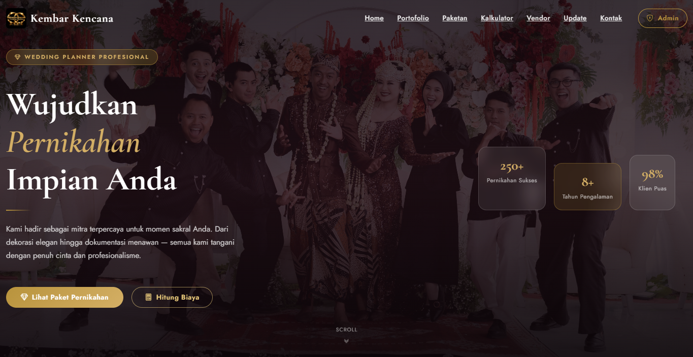
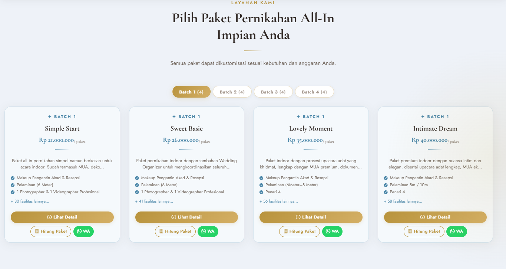
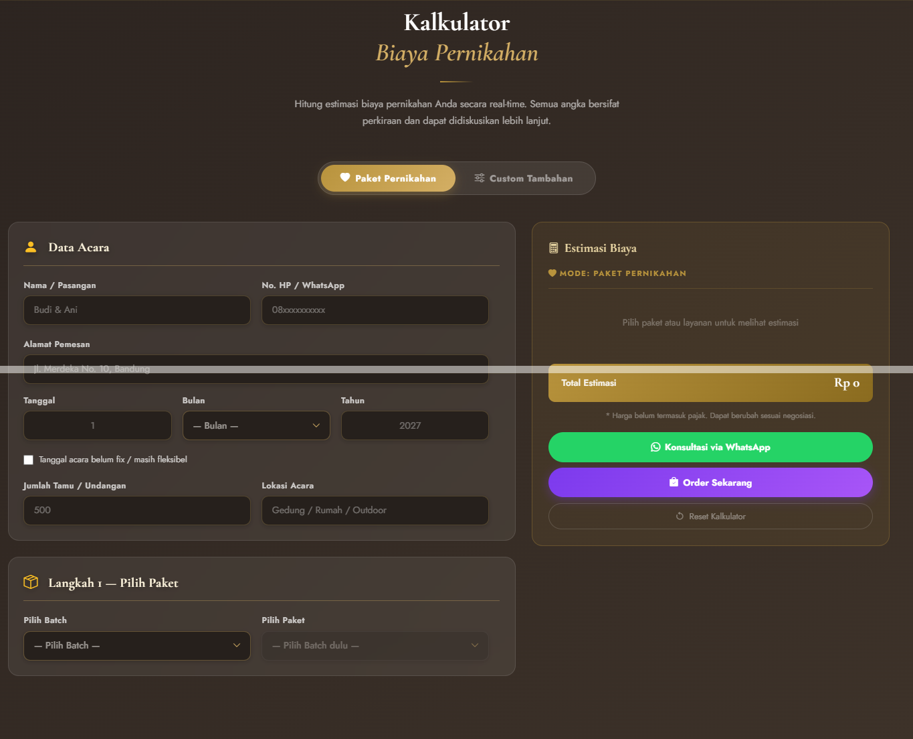
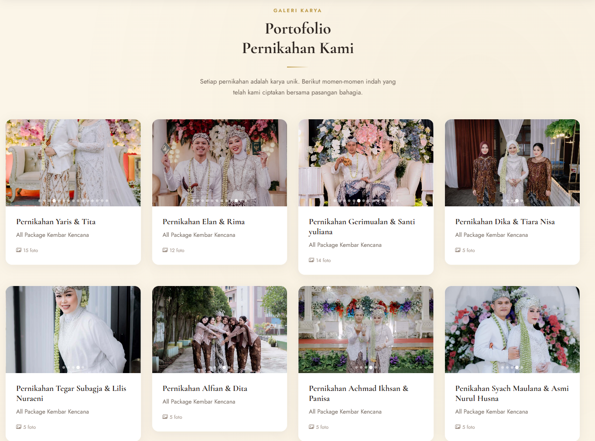
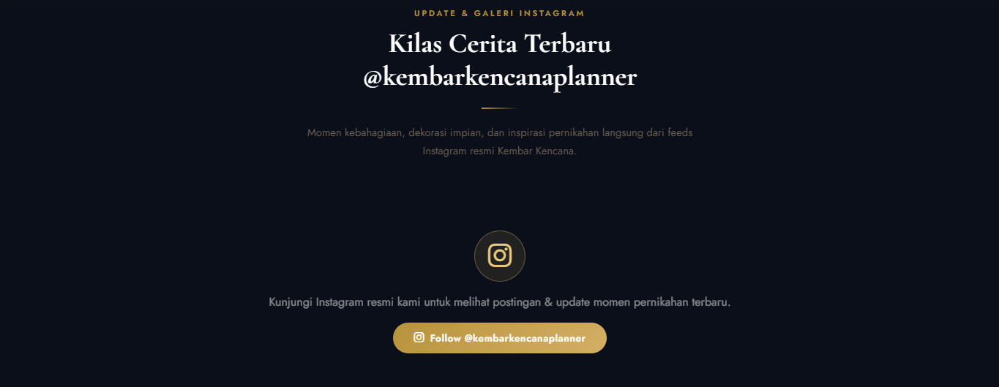
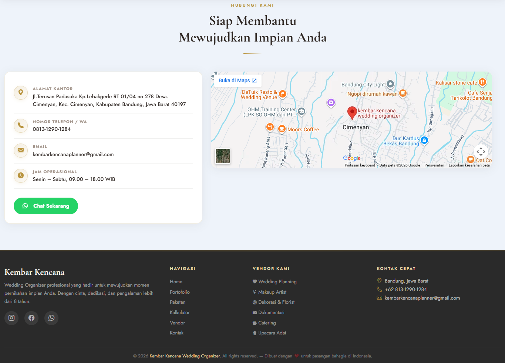
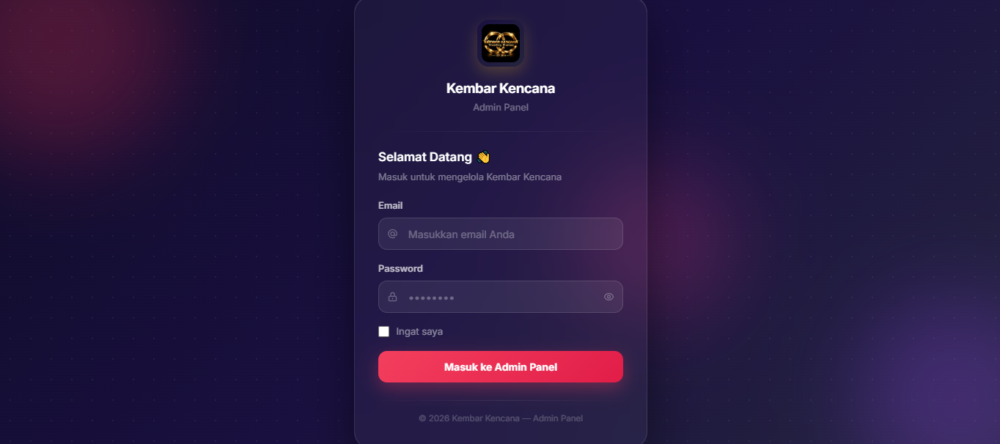

# 💍 Kembar Kencana Wedding Organizer

<p align="center">
  
</p>

<p align="center">
  <strong>Sistem Informasi & Manajemen Wedding Organizer Berbasis Web</strong><br>
  Solusi digital lengkap untuk calon pengantin dan manajemen operasional Kembar Kencana Wedding Organizer.
</p>

<p align="center">
  
  
  
  
</p>

---

## 🌟 Tentang Aplikasi

Aplikasi **Kembar Kencana Wedding Organizer** dirancang untuk mendigitalkan proses pemesanan dan manajemen pernikahan. Calon pengantin dapat menjelajahi paket pernikahan, menghitung estimasi biaya secara interaktif melalui fitur kalkulator, melihat inspirasi dekorasi dan portofolio terkini, hingga melakukan reservasi langsung melalui WhatsApp terintegrasi. Di sisi operasional, pihak wedding organizer memiliki panel admin komprehensif untuk mengelola pesanan, paket, vendor rekanan, venue, serta sinkronisasi feed Instagram.

---

## 📸 Preview & Tangkapan Layar

<div align="center">

### 🏠 Landing Page (Beranda Utama)

<p><em>Tampilan beranda yang elegan, responsif, dan informatif untuk calon pengantin.</em></p>

<br>

### 📦 Pilihan Paket Pernikahan & 🧮 Kalkulator Simulasi Biaya
| Katalog Paket Pernikahan | Kalkulator Simulasi Biaya Interaktif |
| :---: | :---: |
|  |  |

<br>

### 📸 Galeri Portofolio & 📱 Instagram Feed Live
| Dokumentasi Portofolio Event | Live Feed Instagram Kembar Kencana |
| :---: | :---: |
|  |  |

<br>

### 📞 Kontak & Konsultasi Langsung

<p><em>Formulir dan kontak reservasi langsung terhubung dengan WhatsApp tim Wedding Organizer.</em></p>

<br>

### 🔐 Panel Masuk & 📊 Dashboard Admin
| Halaman Login Admin | Dashboard Kontrol Operasional |
| :---: | :---: |
|  |  |

</div>

---

## ✨ Fitur Utama

### 👥 Untuk Pengunjung / Calon Pengantin (Front-End)
- **Katalog Paket Pernikahan & Dekorasi**: Informasi detail mengenai paket yang ditawarkan beserta rincian fasilitas lengkap.
- **Kalkulator Biaya Interaktif**: Simulasi perhitungan biaya paket utama dan pilihan tambahan (add-on) secara real-time.
- **Galeri Portofolio Acara**: Menampilkan dokumentasi acara pernikahan yang telah sukses diselenggarakan.
- **Live Instagram Feed**: Menampilkan postingan terkini langsung dari feed Instagram resmi Kembar Kencana.
- **Formulir Kontak & Direct Booking WhatsApp**: Pengunjung dapat langsung berkonsultasi dan terhubung ke admin dengan ringkasan paket yang dipilih.

### 🛠️ Untuk Pengelola / Admin (Back-End)
- **Ringkasan Dashboard**: Statistik ringkas pesanan masuk, paket aktif, vendor rekanan, dan data keuangan.
- **Manajemen Pesanan (Orders)**: Kelola data reservasi calon pengantin (Pending, Dikonfirmasi, Selesai, Dibatalkan).
- **Manajemen Paket & Dekorasi**: Pengelolaan harga, deskripsi, dan fasilitas paket pernikahan maupun dekorasi.
- **Manajemen Venue**: Pengelolaan lokasi/gedung pernikahan rekanan.
- **Manajemen Vendor Rekanan**: Data vendor MUA, fotografi, katering, MC, dokumentasi, dsb.
- **Sinkronisasi Instagram Feed**: Pengaturan token Instagram Graph API dan sinkronisasi berkala feed ke website.
- **Profil & Keamanan Akun**: Pengaturan nama, email, dan keamanan password admin.

---

## 🛠️ Teknologi yang Digunakan

- **Backend**: [Laravel 12](https://laravel.com/) (PHP 8.2+)
- **Database**: MySQL
- **Frontend**: Blade Templating, HTML5, CSS3, JavaScript, Bootstrap 5
- **Icons & Assets**: FontAwesome, Custom Assets & Photography
- **Integrasi**: Instagram Graph API & WhatsApp Click-to-Chat

---

## 🚀 Panduan Instalasi Lokal

Ikuti langkah-langkah berikut untuk menjalankan proyek ini di komputer lokal:

### 1. Clone Repositori
```bash
git clone https://github.com/HendraPurnama538/WO_KembarKencana_Laravel_12.git
cd WO_KembarKencana_Laravel_12
```

### 2. Instal Dependensi
```bash
composer install
npm install && npm run build
```

### 3. Konfigurasi Environment
Salin file `.env.example` menjadi `.env` lalu buat application key:
```bash
cp .env.example .env
php artisan key:generate
```

Sesuaikan konfigurasi database Anda di file `.env`:
```env
DB_CONNECTION=mysql
DB_HOST=127.0.0.1
DB_PORT=3306
DB_DATABASE=wo_app
DB_USERNAME=root
DB_PASSWORD=
```

### 4. Migrasi & Seeder Database
Jalankan migrasi tabel beserta data awal/seeder:
```bash
php artisan migrate --seed
```

### 5. Buat Symlink Storage
Agar gambar portofolio dan aset upload dapat tampil dengan benar:
```bash
php artisan storage:link
```

### 6. Jalankan Server Lokal
```bash
php artisan serve
```
Akses aplikasi melalui browser di: `http://127.0.0.1:8000`

---

## 👨‍💻 Pengembang

**Hendra Purnama**  
- Email: [purnamahendra484@gmail.com](mailto:purnamahendra484@gmail.com)  
- GitHub: [@HendraPurnama538](https://github.com/HendraPurnama538)

---

<p align="center">
  Dibuat dengan ❤️ untuk <strong>Kembar Kencana Wedding Organizer</strong>
</p>
