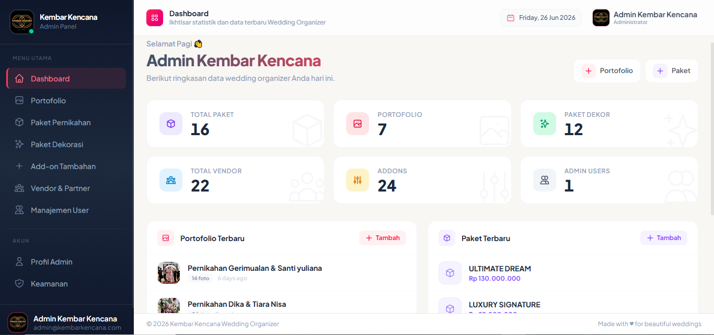
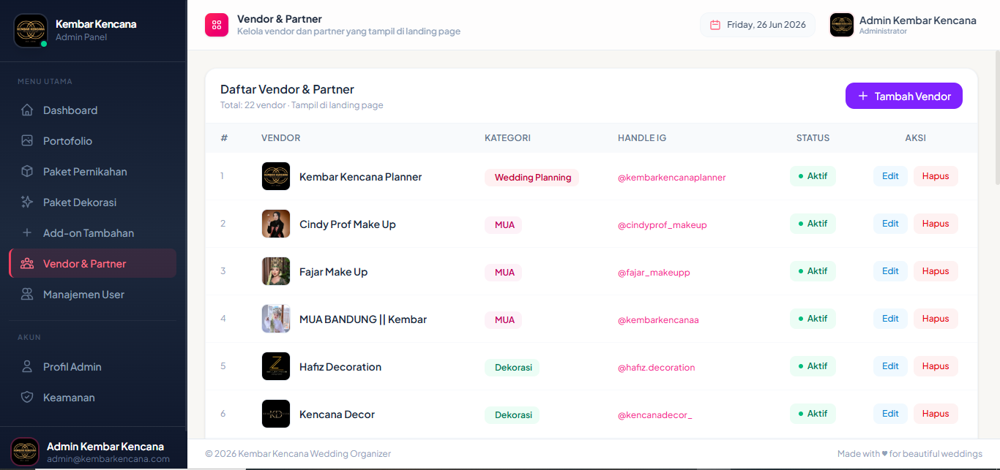
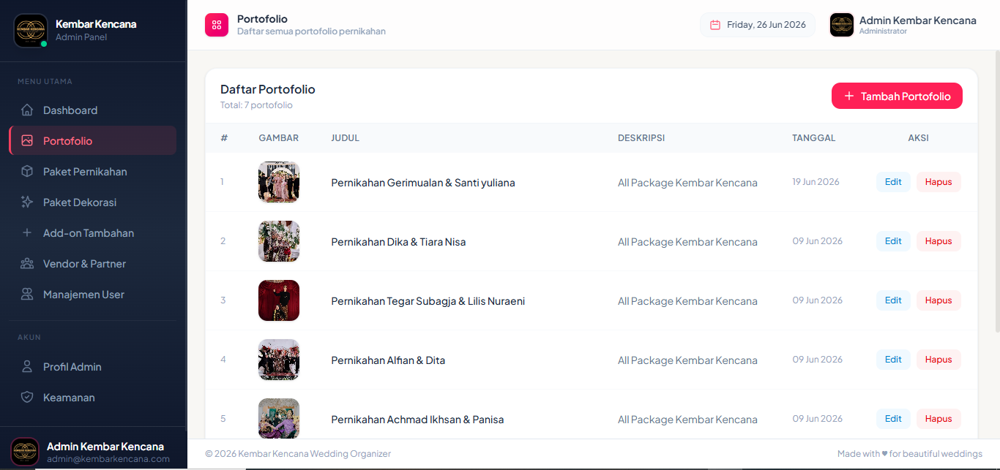

# 💍 Kembar Kencana Wedding Organizer

<p align="center">
  
</p>

<p align="center">
  <strong>Sistem Informasi & Manajemen Wedding Organizer Berbasis Web</strong><br>
  Solusi digital lengkap untuk calon pengantin dan manajemen operasional Kembar Kencana Wedding Organizer.
</p>

<p align="center">
  
  
  
  
</p>

---

## 🌟 Tentang Aplikasi

Aplikasi **Kembar Kencana Wedding Organizer** dirancang untuk mendigitalkan proses pemesanan dan manajemen pernikahan. Calon pengantin dapat menjelajahi paket pernikahan, menghitung estimasi biaya secara interaktif melalui fitur kalkulator, melihat inspirasi dekorasi dan portofolio terkini, hingga melakukan reservasi langsung melalui WhatsApp terintegrasi. Di sisi operasional, pihak wedding organizer memiliki panel admin komprehensif untuk mengelola pesanan, paket, vendor rekanan, venue, serta sinkronisasi feed Instagram.

---

## 📸 Preview & Tangkapan Layar

<div align="center">

### 🏠 Landing Page & Kalkulator Estimasi Biaya

<p><em>Tampilan beranda yang elegan dan responsif untuk pengunjung.</em></p>

<br>

### 🧮 Fitur Simulasi & Kalkulator Pernikahan
| Pemilihan Paket Utama | Pemilihan Tambahan (Add-on) |
| :---: | :---: |
|  |  |

<br>

### 📊 Dashboard & Panel Admin

<p><em>Panel kontrol admin untuk memantau pesanan, omset, dan data operasional.</em></p>

<br>

### 🤝 Manajemen Vendor & Portofolio
| Manajemen Vendor Rekanan | Galeri Portofolio & Event |
| :---: | :---: |
|  |  |

</div>

---

## ✨ Fitur Utama

### 👥 Untuk Pengunjung / Calon Pengantin (Front-End)
- **Katalog Paket Pernikahan & Dekorasi**: Informasi detail mengenai paket yang ditawarkan beserta rincian fasilitas.
- **Kalkulator Biaya Interaktif**: Simulasi perhitungan biaya paket utama dan paket add-on secara real-time.
- **Galeri Portofolio & Testimoni**: Menampilkan dokumentasi acara pernikahan yang telah sukses diselenggarakan.
- **Instagram Feed Integration**: Live feed update langsung dari akun media sosial Instagram resmi.
- **Konsultasi & Direct Booking WhatsApp**: Pengunjung dapat langsung terhubung ke admin dengan rincian paket yang dipilih.

### 🛠️ Untuk Pengelola / Admin (Back-End)
- **Ringkasan Dashboard**: Statistik total paket, pesanan masuk, vendor aktif, dan grafik performa.
- **Manajemen Pesanan (Orders)**: Kelola status reservasi (Pending, Dikonfirmasi, Selesai, Dibatalkan) dan rincian pesanan.
- **Manajemen Paket & Dekorasi**: Tambah, ubah, dan nonaktifkan paket pernikahan maupun dekorasi.
- **Manajemen Venue**: Pengelolaan lokasi/gedung pernikahan yang bekerja sama.
- **Manajemen Vendor Rekanan**: Pencatatan vendor MUA, fotografi, katering, MC, dsb.
- **Sinkronisasi Instagram**: Pengaturan API token dan sinkronisasi berkala feed Instagram.
- **Profil & Pengaturan Akun**: Pengelolaan keamanan akun dan data profil admin.

---

## 🛠️ Teknologi yang Digunakan

- **Backend**: [Laravel 12](https://laravel.com/) (PHP 8.2+)
- **Database**: MySQL
- **Frontend**: Blade Templating, HTML5, CSS3, JavaScript, Bootstrap 5 / Tailwind CSS
- **Icons & Assets**: FontAwesome, Custom Photography & Design Assets
- **Integrasi**: Instagram Graph API & WhatsApp Click-to-Chat

---

## 🚀 Panduan Instalasi Lokal

Ikuti langkah-langkah berikut untuk menjalankan proyek ini di komputer lokal:

### 1. Clone Repositori
```bash
git clone https://github.com/HendraPurnama538/WO_KembarKencana_Laravel_12.git
cd WO_KembarKencana_Laravel_12
```

### 2. Instal Dependensi
```bash
composer install
npm install && npm run build
```

### 3. Konfigurasi Environment
Salin file `.env.example` menjadi `.env` lalu buat application key:
```bash
cp .env.example .env
php artisan key:generate
```

Sesuaikan konfigurasi database Anda di file `.env`:
```env
DB_CONNECTION=mysql
DB_HOST=127.0.0.1
DB_PORT=3306
DB_DATABASE=nama_database_anda
DB_USERNAME=root
DB_PASSWORD=
```

### 4. Migrasi & Seeder Database
Jalankan migrasi tabel beserta data awal/seeder:
```bash
php artisan migrate --seed
```

### 5. Buat Symlink Storage
Agar gambar portofolio dan banner dapat tampil dengan benar:
```bash
php artisan storage:link
```

### 6. Jalankan Server Lokal
```bash
php artisan serve
```
Akses aplikasi melalui browser di: `http://127.0.0.1:8000`

---

## 👨‍💻 Pengembang

**Hendra Purnama**  
- Email: [purnamahendra484@gmail.com](mailto:purnamahendra484@gmail.com)  
- GitHub: [@HendraPurnama538](https://github.com/HendraPurnama538)

---

<p align="center">
  Dibuat dengan ❤️ untuk <strong>Kembar Kencana Wedding Organizer</strong>
</p>
